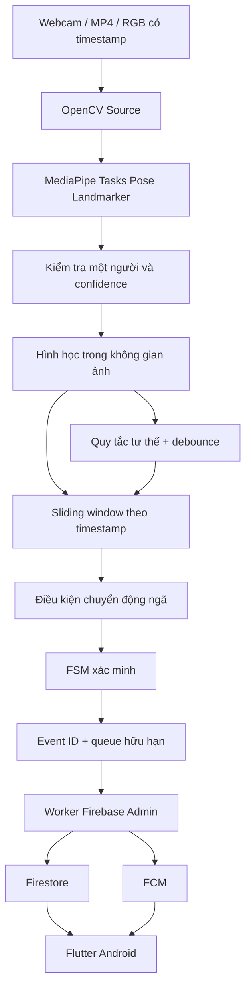

# Kiến trúc V1

`Engine.process()` không nhập Firebase, camera hoặc MediaPipe. Có thể tái sử dụng cho V2. Feature Engineering và Motion Analysis độc lập với backend và classifier. MediaPipe chỉ cung cấp pose pretrained; không có Random Forest/SVM/KNN/LSTM hoặc huấn luyện phân loại.

Camera/inference chạy trên luồng giao diện OpenCV. Worker mạng riêng giữ snapshot mới nhất và queue tối đa 128 sự kiện; không có network call trong luồng webcam sau bước preflight. Thay đổi trạng thái được gộp tối thiểu 15 giây khi gửi cloud; heartbeat 30 giây. Sự kiện cảnh báo được giữ theo ID, tạo document idempotent. Lỗi mạng retry lùi 1–30 giây; queue đầy báo lỗi rõ và cần xem telemetry cục bộ. Không có lưu trữ offline bền vững; khởi động lại có thể mất sự kiện chưa gửi.

`Publisher` chỉ nhận profile ID đã provision, kiểm tra credential đúng project, không cho truyền collection tùy ý. Admin SDK bỏ qua Rules: cần bảo vệ máy laptop và file key. Rules bảo vệ client Flutter, không thể thu hẹp Admin credential bằng Rules.

Không truyền frame, landmarks, hình ảnh hoặc video lên Firebase. Các cache landmarks chỉ nằm trong project để đánh giá. Status cloud chỉ chứa tư thế, FSM, trạng thái người/camera, heartbeat và ID sự kiện. Không có dữ liệu minh họa tự điền lên dashboard.

Danh tính V1: khởi động trong cảnh một người. Khi có nhiều pose, chỉ chọn nếu đúng một pose nằm trong bán kính0,6 độ dài thân từ mục tiêu trước; nếu nhập nhằng thì bỏ mẫu, không tự đổi người. Một frame nhập nhằng không khóa vĩnh viễn. Mất dấu lâu hơn3 giây hoặc nhảy vị trí quá2 độ dài thân cần nhấn R. Đây là khóa liên tục hình học, không phải nhận dạng sinh trắc học. Không bảo đảm phân biệt hai người thay chỗ nhanh tại cùng vị trí; yêu cầu môi trường một người. Detection trùng hoặc bỏ sót vẫn có thể gây false negative.

Bản1.2 có cảnh báo sớm SUSPECTED_FALL khi đủ tổ hợp chuyển động; cùng ID được cập nhật kết quả xác minh sau đó. Đây vẫn là nghi ngờ, không kết luận chắc chắn ngã. Cảnh báo được giữ để người thân kiểm tra ngay cả khi về sau camera thiếu bằng chứng; UNVERIFIED_CANDIDATE không đồng nghĩa đã an toàn. Chi tiết cảnh báo hiển thị kết quả xác minh riêng với seenAt/safeAt.

Flutter lấy danh sách hồ sơ từ `users/{uid}/profiles`; không query toàn bộ collection profiles. Khi mở alert từ thông báo vẫn phải vượt Security Rules. Dashboard kiểm tra heartbeat mỗi 10 giây, quá 90 giây hoặc dữ liệu chỉ có cache sẽ không hiển thị trạng thái trực tiếp.

Trước khi mở nội dung hồ sơ hoặc alert từ notification, Flutter kiểm tra membership trực tiếp từ server. Không dựa vào document đã cache của tài khoản trước để cấp quyền mở nội dung; mất mạng ở bước này hiển thị lỗi và nút thử lại. Rules vẫn kiểm soát mọi truy cập server.
