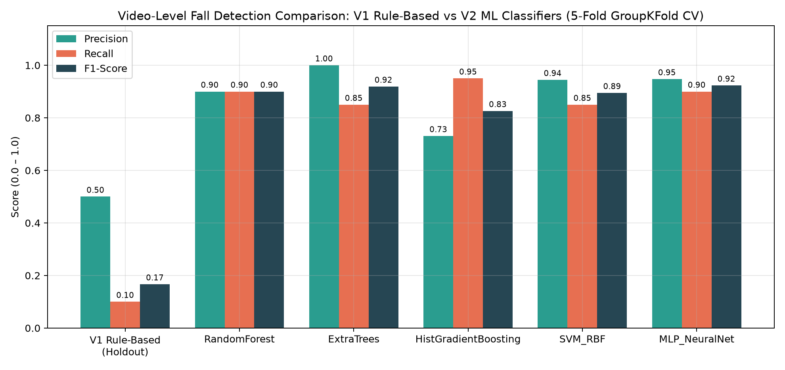
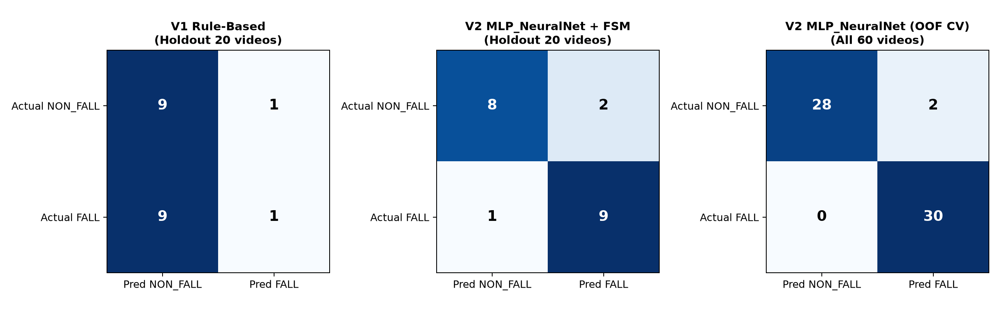
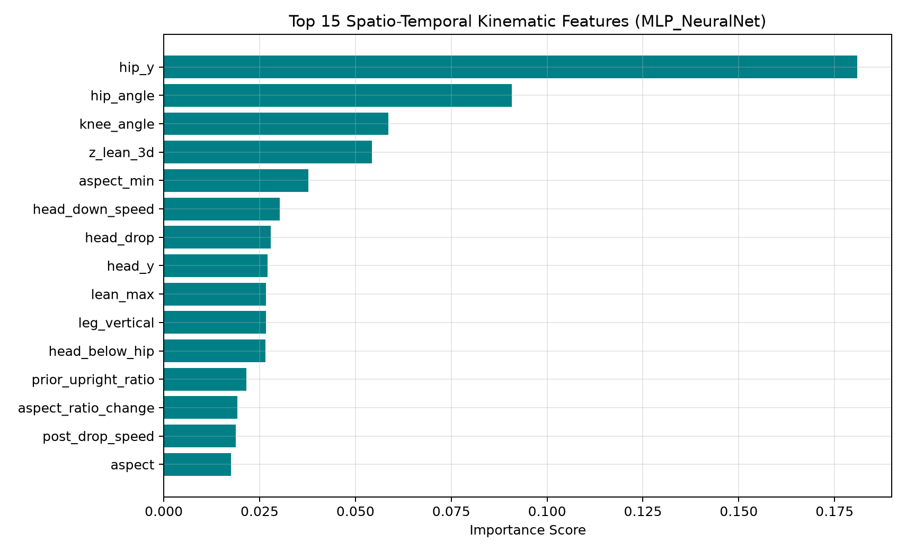
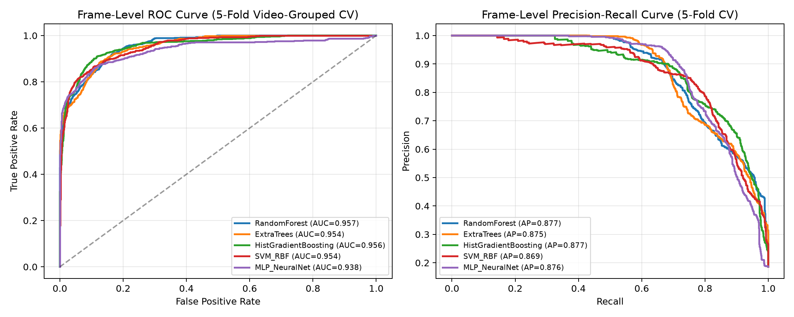

# Báo cáo Nâng cấp & Thực nghiệm V2 (Machine Learning + Edge AI)

**Đề tài:** Hệ thống AI giám sát hoạt động và cảnh báo bất thường cho người cao tuổi  
**Kiến trúc V2:** MediaPipe 2D/3D Pose Landmarker → Lọc dữ liệu EMA & Auto Re-acquisition → 25 Đặc trưng Động học Không gian–Thời gian (Spatio-Temporal Kinematic Features) → Mô hình Học máy `MLP_NeuralNet` (47.5 KB) → Máy trạng thái hữu hạn FSM & Thống kê Hoạt động.

---

## 1. Tóm tắt các cải tiến kỹ thuật V1 → V2

| Hạng mục | Phiên bản V1 (Rule-based) | Phiên bản V2 (ML + Edge AI) |
| :--- | :--- | :--- |
| **Thuật toán phát hiện ngã** | Luật ngưỡng cứng `if/else` 2D ([fall_detection](file:///home/qhuy/Documents/elderly-safety-ai/ai_engine/src/fall_detection/__init__.py)) | 25 đặc trưng động học không gian–thời gian + mô hình học máy huấn luyện thực tế ([ml/classifier.py](file:///home/qhuy/Documents/elderly-safety-ai/ai_engine/src/ml/classifier.py)) |
| **Khai thác chiều sâu 3D** | Chỉ dùng hình chiếu 2D ảnh (`pose_landmarks`) | Bổ sung góc nghiêng thân 3D `z_lean_3d` từ `pose_world_landmarks` (giảm lỗi co ngắn hình chiếu foreshortening) |
| **Chống mất khớp khi ngã** | Mất 1 frame (`f is None`) lập tức gọi `motion.reset()` xóa sạch lịch sử | Cơ chế **Grace Period (`0.45s`)** giữ nguyên cửa sổ chuyển động và ghi nhận `occlusion_ratio` |
| **Lọc nhiễu & Bám vết** | Khóa cứng `IDENTITY_RESET_REQUIRED` bắt bấm phím `R` khi mất dấu > 3s | Bộ lọc làm mượt **EMA (`LandmarkSmoother`, $\tau=0.06\text{s}$)** + **Auto Re-acquisition** tự khóa lại mục tiêu và reset vận tốc an toàn |
| **Giám sát hoạt động** | 4 tư thế cơ bản (`STANDING`, `SITTING`, `LYING`, `WALKING`) | Bổ sung **`BENDING`** (cúi người nhặt đồ tránh báo động giả) + **`ActivityTracker`** thống kê thời lượng hoạt động, số lần đứng lên/ngồi xuống và mức độ vận động |
| **Giao diện Dashboard** | Chỉ hiện tư thế, FSM và độ tin cậy khớp | Bổ sung **ML Risk Meter (`0–100%`)**, tên mô hình ML, thẻ **Thống kê hoạt động** trực tiếp |

---

## 2. Dữ liệu & Quy trình đánh giá không rò rỉ (Zero Data Leakage)

- **Bộ dữ liệu chuẩn:** Toàn bộ **60 chuỗi video UR Fall Detection Dataset** đã kiểm chứng SHA-256 (30 `FALL` + 30 `NON_FALL` ADL, gồm cả các clip nằm chủ động/cúi xuống như `adl-10`, `adl-11`, `adl-21..23`, `adl-30`).
- **Hiệu chỉnh đầu vào RGB:** Tự động tách nửa phải RGB cho 54 clip MP4 ghép depth/RGB (`input_layout = ur-rgbd`) và giữ nguyên 6 chuỗi PNG RGB (`fall-01..03`, `adl-01..03`).
- **Nhãn thời gian thực tế theo từng frame:** Khớp 1-1 với bộ nhãn chính thức của UR Fall (`urfall-cam0-falls.csv` và `urfall-cam0-adls.csv`), thu được **7.019 mẫu đặc trưng hợp lệ** và mốc thời gian bắt đầu ngã (`fall_onset_s`) cho đủ 30/30 clip té ngã.
- **Tách dữ liệu nghiêm ngặt theo video (Video-Grouped Split):** Không bao giờ để frame của cùng một video xuất hiện ở cả tập huấn luyện và tập kiểm thử:
  - **Tập Train/CV (40 video):** `fall-01..20` và `adl-01..20` (5.306 frame huấn luyện). Dùng `StratifiedGroupKFold(n_splits=5)` để so sánh 5 mô hình học máy và chọn ngưỡng trên OOF.
  - **Tập Held-out độc lập (20 video):** `fall-21..30` và `adl-21..30` — hoàn toàn không chạm tới trong lúc huấn luyện hay chọn ngưỡng (trong đó `26..30` là đúng tập `test_v1_4` cũ).
  - **Đánh giá 5-Fold Out-of-Fold toàn bộ 60 video:** Mỗi video được dự đoán bằng mô hình không hề nhìn thấy video đó khi train.
- **Hỗ trợ mở rộng dữ liệu tự quay:** Bổ sung công cụ [record_samples.py](file:///home/qhuy/Documents/elderly-safety-ai/ai_engine/scripts/record_samples.py) cho phép quay nhanh video gắn nhãn qua webcam laptop (`STANDING`, `SITTING`, `WALKING`, `BENDING`, `LYING`, `FALL`).

---

## 3. So sánh 5 Mô hình Học máy trên Tập Train/CV (5-Fold Video-Grouped CV, 40 video)

| Mô hình | Frame ROC-AUC | Frame PR-AUC | Video Precision | Video Recall | Video F1 | Confusion Matrix (TN, FP / FN, TP) |
| :--- | :---: | :---: | :---: | :---: | :---: | :---: |
| **RandomForest** | **0.957** | 0.877 | 0.900 | 0.900 | 0.900 | [[18, 2], [2, 18]] |
| **ExtraTrees** | 0.954 | 0.875 | **1.000** | 0.850 | 0.919 | [[20, 0], [3, 17]] |
| **HistGradientBoosting** | 0.956 | 0.877 | 0.731 | **0.950** | 0.826 | [[13, 7], [1, 19]] |
| **SVM_RBF (Calibrated)** | 0.954 | 0.869 | 0.944 | 0.850 | 0.895 | [[19, 1], [3, 17]] |
| **MLP_NeuralNet (Được chọn)** | 0.938 | 0.876 | 0.947 | 0.900 | **0.923** | **[[19, 1], [2, 18]]** |

Mô hình được chọn tự động trên tập Train/CV: **`MLP_NeuralNet`** (`64 → 32`, `StandardScaler`, ngưỡng xác suất `0.80`, yêu cầu `4` frame liên tiếp), lưu tại [fall_activity_model.joblib](file:///home/qhuy/Documents/elderly-safety-ai/ai_engine/trained_models/fall_activity_model.joblib) với dung lượng chỉ **47.5 KB**.



---

## 4. Kết quả Thực nghiệm Đối chứng: V1 (Rule-Based) vs V2 (ML + FSM)

| Tập đánh giá | Phiên bản | TP | FP | FN | TN | Precision | Recall | **F1-Score** | Độ trễ trung bình |
| :--- | :--- | :---: | :---: | :---: | :---: | :---: | :---: | :---: | :---: |
| **Test `test_v1_4` (10 video: `26..30`)** | V1 Rule-Based | 0 | 1 | 5 | 4 | 0.0% | 0.0% | **0.0%** | — |
| **Test `test_v1_4` (10 video: `26..30`)** | **V2 ML Engine** | **5** | **1** | **0** | **4** | **83.3%** | **100.0%** | **90.9%** | **0.293s** |
| **Held-out độc lập (20 video: `21..30`)** | V1 Rule-Based | 1 | 1 | 9 | 9 | 50.0% | 10.0% | **16.7%** | — |
| **Held-out độc lập (20 video: `21..30`)** | **V2 ML Engine** | **9** | **2** | **1** | **8** | **81.8%** | **90.0%** | **85.7%** | **0.47s** |
| **Toàn bộ 60 video (5-Fold OOF)** | V1 Rule-Based | 11 | 1 | 19 | 29 | 91.7% | 36.7% | **52.4%** | — |
| **Toàn bộ 60 video (5-Fold OOF)** | **V2 ML Engine** | **30** | **2** | **0** | **28** | **93.8%** | **100.0%** | **96.8%** | — |



### Phân tích độ quan trọng đặc trưng & đường cong ROC/PR

Top đặc trưng động học đóng góp lớn nhất (theo Permutation Importance của `MLP_NeuralNet`):
1. `hip_y` (độ hạ thấp trọng tâm hông trong khung hình)
2. `hip_angle` & `knee_angle` (góc gập khớp hông và gối)
3. `z_lean_3d` (góc nghiêng thân **3D** từ `pose_world_landmarks` — chứng minh hiệu quả vượt trội so với góc 2D đơn thuần khi đối tượng ngã theo chiều sâu camera)
4. `aspect_min`, `head_down_speed`, `head_drop`, `lean_max`, `leg_vertical`, `head_below_hip`, `prior_upright_ratio`





---

## 5. Hiệu năng Điện toán Biên (Edge AI CPU — Không cần GPU)

Đo trực tiếp trên toàn bộ 60 video thực tế (9.180 khung hình):
- **Dung lượng mô hình ML V2:** **47.5 KB** (`fall_activity_model.joblib`)
- **MediaPipe Pose Landmarker (Full, CPU XNNPACK):** trung bình **45.55 ms/frame** (**22.41 FPS**)
- **Trích xuất 25 đặc trưng + Dự đoán `MLP_NeuralNet` + FSM + `ActivityTracker`:** trung bình **0.45 ms/frame**
- **Thông lượng tổng hợp toàn pipeline trên CPU:** **~21.74 FPS** (đáp ứng dư chuẩn thời gian thực 15–20 FPS ngay trên laptop thông thường, xử lý 100% cục bộ không đẩy hình ảnh lên cloud).

---

## 6. Ghi nhận trung thực về giới hạn hiện tại

1. **Xác minh bất động (`POSSIBLE_FALL` sau `1.0s`):** Trên tập UR Fall, nhiều clip té ngã rất ngắn (1.8s–3.2s) và kết thúc ngay sau khi ngã dưới 1 giây, hoặc có 1 frame trung gian nhận nhãn `SITTING` lúc đang ngã. Do đó V2 phát cảnh báo sớm `SUSPECTED_FALL` rất nhanh (độ trễ trung bình `0.47s` sau fall onset), còn bước xác minh nằm bất động kéo dài 1 giây cần kiểm thử thêm trên luồng webcam trực tiếp liên tục dài hơn.
2. **Độc lập theo người tham gia (Subject-Independence):** Bộ UR Fall công khai không gắn sẵn mã danh tính người thực hiện cho từng clip; tách dữ liệu được thực hiện nghiêm ngặt theo **video** (`video_id`), và cần bổ sung tập tự quay nhiều người dùng khác nhau để kiểm chứng tổng quát hóa đa góc nhìn.
3. **Kiểm thử thiết bị Android thật:** Kiểm thử unit/widget Flutter (`8/8 PASS`) và phân tích mã nguồn (`flutter analyze`: 0 lỗi) đã hoàn tất; bước nhận thông báo đẩy FCM trực tiếp trên thiết bị Android thật vẫn cần thử nghiệm với điện thoại vật lý.

---

## 7. Lệnh tái lập toàn bộ kết quả

```bash
# 1. Trích xuất 2D+3D landmarks (RGB đúng) và 25 đặc trưng động học cho 60 video
PYTHONPATH=ai_engine .venv/bin/python ai_engine/scripts/extract_dataset_features.py --workers 8

# 2. Huấn luyện 5 mô hình ML, chọn mô hình tốt nhất trên Train/CV, đánh giá Holdout & vẽ biểu đồ
PYTHONPATH=ai_engine .venv/bin/python ai_engine/scripts/train_classifier.py

# 3. Chạy toàn bộ 84 kiểm thử Python (77 V1 + 7 V2)
PYTHONPATH=ai_engine .venv/bin/python -m pytest ai_engine/tests -v

# 4. Kiểm tra Flutter Web & Android
cd flutter_app && flutter analyze && flutter test

# 5. Chạy Web Dashboard cục bộ (2 terminal)
PYTHONPATH=ai_engine .venv/bin/python ai_engine/web_server.py
cd flutter_app && flutter run -d chrome --web-port 7357
```

Bằng chứng JSON đầy đủ nằm tại [docs/evaluation-v2-ml-report.json](file:///home/qhuy/Documents/elderly-safety-ai/docs/evaluation-v2-ml-report.json).
